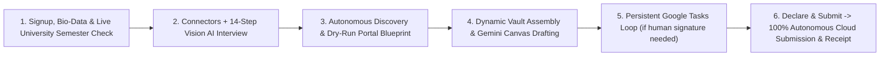
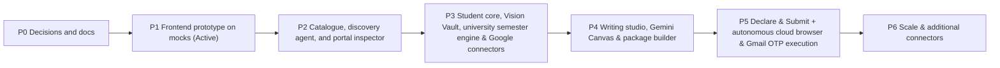

# 01 · Strategy: how Artrat actually happens

## The one-line product

**Artrat gets a student from "I don't know what I qualify for" to "submitted, on time, with proof", and does the work while they sleep.**

## 1. Why students lose scholarships today — and how Artrat solves every stage

A scholarship listing page rarely tells the whole truth about an application. The real requirements—exact form fields, separate upload slots for School Admission Letter vs. JAMB Admission Letter, PDF size limits, word caps, and whether a specific endorsement letter (from an Academic Referee, Mentor, Guarantor, or HOD) or Bank Statement is required—live inside the application portal itself.

| Where students lose today | Artrat's answer | Student effort |
|---------------------------|-----------------|----------------|
| Never hear about the opportunity | **Continuous, verified discovery** across official websites, search engines, and social media (X, LinkedIn, Instagram, Telegram) | Zero |
| Waste hours on portals they don't qualify for | **Strict Binary Eligibility Gate** after a safe dry-run portal inspection (no misleading "90% match" percentages) | Zero |
| Overwhelmed by upfront forms | **Conversational AI Onboarding Interview with Vision OCR** that extracts facts one-by-one from WAEC, JAMB, School Admission Letter, JAMB Admission Letter, School/Dept/Library ID, NIN, Passport, CV, and Transcript | Conversational chat + uploads |
| University calendars change due to strikes/shifts | **Live University Semester Check & Global School Cache** that tracks each university's real active semester and promotes student levels autonomously | Zero (with manual override in Settings) |
| Missing a specific endorsement or on-request document | **Dynamic Vault + Persistent Google Tasks & Calendar Loop** that drafts the request letter and nudges the student until the signed scan is uploaded | Upload the signed scan |
| Weak or generic essays | **Evidence-grounded drafts** weaving the student's real projects, community roots, family/sponsorship story, and voice—editable in **Gemini Canvas** | Review or tweak in Canvas |
| Miss verification codes during portal submission | **100% Autonomous Gmail OTP Pickup**—Artrat reads portal verification codes from connected Gmail automatically without asking the student to type OTPs manually | Zero |
| Tedious form filling and portal submission | **One-Tap `Declare & Submit` -> End-to-End Cloud Execution** (plus downloadable `.DOCX` and `.PDF` **Submission Kits** at any time) | One tap (**Declare & Submit**) |

---

## 2. The six-stage operating loop

1. **Signup, Bio-Data & Live University Semester Engine:**
   - New students complete Sign-Up, enter Bio-Data (DOB Date Picker, cascading Nigerian State & 774 LGA dropdowns, residential writing address—without upfront CGPA/UTME typing), and select their university.
   - Artrat runs a **live university semester check** (independent of static school calendars), caches that university's active session/semester globally so subsequent students from the same school don't re-trigger the check, and uses it to autonomously promote the student's level across sessions (with a manual force-level override in Settings).
2. **Connected Apps & Conversational AI Interview:**
   - Students connect **Google Tasks**, **Google Calendar**, **Gmail** (autonomous OTP pickup + receipt capture), **Google Drive**, and the **Instant Bank Statement Connector (Mono / Okra)** for on-request financial verification.
   - Before entering the workspace, Artrat conducts a **one-by-one interactive AI interview** (`docs/09-onboarding-discovery-interview-spec.md`): collecting core documents with Vision OCR extraction, building or auditing their CV section-by-section, conversing about their personal statement, community origin, parents' status (living/deceased for orphan/fatherless scholarships), sponsor details, and disability status, and finishing with their Transcript (or Exam Officer-compiled semester results).
3. **Continuous Discovery & Dry-Run Portal Inspection:**
   - Artrat scouts official sources and social feeds, and inspects each target portal in a safe dry run (`PortalBlueprint`) before touching student data.
4. **Autonomous Preparation & Dynamic Vault:**
   - The Vault is **completely dynamic**: if a scholarship requires a new document tomorrow (e.g., an Academic Mentor recommendation, Guarantor form, Pastor/Imam letter, HOD verification, LGA Certificate, or Bank Statement), Artrat requests it inside that Application Chat, stores it in the Vault, and syncs it globally across all applications.
5. **Relentless Connector Follow-Through:**
   - For any pending physical signature, Artrat syncs a persistent reminder to **Google Tasks** and **Google Calendar** that cannot be bypassed by ticking it off externally until the validated document is uploaded in Artrat.
6. **Declare & Submit -> 100% Autonomous Execution:**
   - Once all portal items are ready, the student taps **Declare & Submit** once. Artrat's cloud browser fills the portal, uploads every document, fetches any email OTPs autonomously from Gmail, submits the application, and saves the official confirmation receipt to the Vault (while also providing a downloadable `.DOCX` / `.PDF` Submission Kit).

---

## 3. Six strategic pillars

1. **Two contexts, one product.** The **Catalogue** (global, shared, no personal data, plus cached University Semester states and Portal Blueprints) and the **Student** context (private, per student) are strictly separated: Student reads Catalogue; the discovery agent never reads private student rows.
2. **Demand-driven global discovery + Student Link-Drop enrichment.** The discovery agent prioritizes research directions using anonymised aggregate demand signals and immediately enriches its global discovery library whenever a student drops an uncaptured scholarship link in the chatbox.
3. **Every fact is a Claim.** Opportunity fields and Portal Blueprint rules are stored as Claims with value, verbatim source passage, URL, retrieval time, and verification level (ADR-0006).
4. **Dynamic AI behaviour over hardcoded static rules.** Nothing in Artrat's document or referee model is static. Whether a portal asks for an academic mentor, guarantor, referee, departmental endorsement, or on-request bank statement, Artrat adapts dynamically and syncs updates globally across the Vault and all Application Chats.
5. **100% autonomous execution with version-bound consent.** Connecting Gmail eliminates manual OTP handoffs during portal submission, while `Declare & Submit` binds the student's explicit approval to the exact cryptographic hash of the prepared package.
6. **Frontend first, against a typed contract.** The Expo app (`apps/mobile`) is built and verified against typed domain schemas and `MockArtratApi` before backend infrastructure is spun up (ADR-0005).

---

## 4. Who it is for first

**Beachhead:** Nigerian university undergraduates (`100 Level` to `600 Level`—**including under-18 students, who make up a large share of 100L–200L undergraduates**), JAMB/university entrants, and recent graduates applying for local and international scholarships.

- **Under-18 first-class support:** Many Nigerian undergraduates enter university at 15–17. Artrat supports under-18 students from day one with age-appropriate privacy defaults computed automatically from their DOB Date Picker, plain-language consent, and Nigeria Data Protection Act (NDPA) 2023 compliance.
- **Mobile & Web reality:** Android-first, iOS, and responsive Desktop Web from one Expo codebase; fast animations on mid-range devices, offline-tolerant caching, and data-conscious assets.
- **Authentic Nigerian academic context:** Native support for WAEC/NECO, JAMB UTME result slips, **separate** University Admission Letters and JAMB CAPS Admission Letters, University/Departmental/Library IDs, 5.0-scale CGPAs, Exam Officer-compiled result sheets, all 36 States + FCT and 774 LGAs, and NUBAN bank details.

---

## 5. Measures of success

| Kind | Metric | Why |
|------|--------|-----|
| North star | **On-time verified submissions per active student per quarter** | Counts real outcomes, not browsing activity |
| Onboarding completion | Share of new students completing the 14-step AI Interview & Vision Vault setup | Measures conversational pacing and Vision OCR delight |
| Portal coverage | Share of matched portals with a verified Portal Blueprint and 100% autonomous execution | Measures automation reach |
| Document closure | Share of missing third-party endorsement Tasks closed by a validated upload before the deadline | Measures Google Tasks / Calendar trigger effectiveness |
| Catalogue quality | Precision: share of shown opportunities that are current and accurately mapped (target >=95%) | Trust collapses if listings are stale |
| Writing integrity | Unsupported-claim rate in drafts (target `0`) | Every sentence maps to the student's Evidence Ledger |
| Safety | Duplicate submissions, tasks, or calendar events (target `0`) | Idempotency holds across retries |
| Cost | Cost per completed application (model tokens + browser minutes) | Unit economics |

## 6. What Artrat will not do

- Show meaningless qualification percentages (e.g., "90% qualified") when a student fails a hard requirement.
- Merge distinct documents like the **Admission Letter from School** and **Admission Letter from JAMB**.
- Treat a single example requirement (like an HOD letter) as a hardcoded upfront profile requirement; endorsements are requested dynamically per scholarship.
- Ask the student to manually type email OTPs when Gmail is connected for autonomous OTP pickup.
- Invent personal facts, grades, or experiences, or bypass CAPTCHAs, MFA, or fee payments.

## 7. Phases at a glance

Detail lives in [`07-roadmap.md`](07-roadmap.md).

