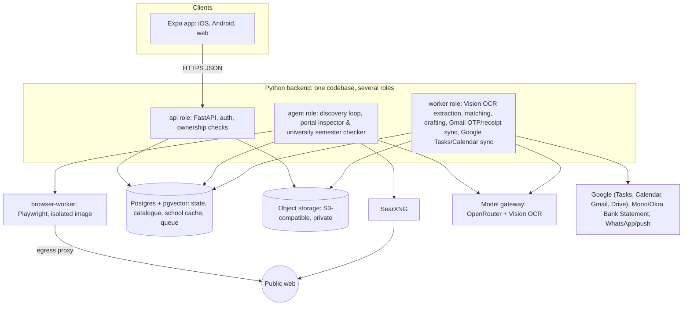
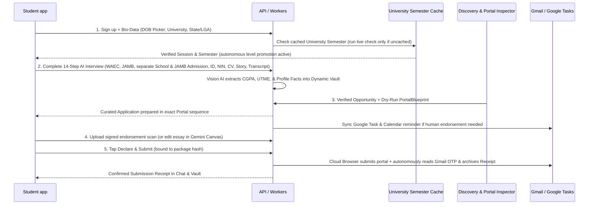

# 03 · Architecture

Target shape for Artrat. Decisions with lasting cost are recorded in `docs/adr/`. Everything else here can change cheaply.

## Principles

1. **One choice per responsibility.** No overlapping frameworks without a benchmark that names the winner (from S5 Addendum G).
2. **Modular monolith first.** One Python backend codebase with several process roles. Split services only for isolation (the browser) or proven scaling need.
3. **Postgres is the source of truth** for product state, university semester cache, research state, and the job queue.
4. **Code enforces gates; models propose.** The LLM and Vision models produce structured proposals. Typed code validates and executes them.
5. **Same containers everywhere.** Docker Compose on a laptop or VPS; the same images on a managed cloud.

## System diagram



## Components

| Component | Technology | Responsibility | Must not |
|-----------|-----------|----------------|----------|
| Client | Expo (React Native, TypeScript), Three.js (`ArtratBot3D`), Zod | All student UX (Onboarding AI Interview, Home, Applications Chat, Gemini Canvas, Dynamic Vault, Reminders, Settings); web build for desktop use | Hold secrets, own workflow state |
| API role | Python 3.12, FastAPI, Pydantic v2 | Auth, validation, ownership, Declare & Submit transaction, Submission Kit `.DOCX`/`.PDF` export, read models for the app | Run long jobs inline |
| Agent role | Python, custom planner | Discovery loop over the research frontier (`05-discovery-agent.md`), dry-run Portal Inspector (`PortalBlueprint`), and Live University Semester Check (cached per school) | Read private student data |
| Worker role | Python, job queue | Vision OCR extraction (Docling + Vision LLM), strict binary matching, Evidence-Ledger drafting, Google Tasks/Calendar trigger loop, autonomous Gmail OTP pickup & receipt archival, Mono/Okra bank statement pull | Write Catalogue rows (except the extraction pipeline acting for the agent) |
| Browser worker | Playwright (Python), separate image | Rendering JS-heavy pages for discovery & dry-run Portal Blueprint mapping; isolated per-job cloud execution after `Declare & Submit` | Reach private networks; share sessions across students |
| Database | Postgres 16 + pgvector | Single source of truth (Catalogue, University Semester Cache, Student Profile Facts, Dynamic Vault, Applications); row-level security for student tables | Store raw tokens in plain text |
| Job queue | Postgres-backed (Procrastinate or equivalent) | Durable jobs, retries, recurring Google Tasks trigger schedules | Become a second source of truth |
| Object storage | S3-compatible (MinIO locally; S3, R2, or Azure Blob in cloud) | Dynamic Vault documents, Submission Kits, page snapshots | Serve public URLs for student documents |
| Search | SearXNG (self-hosted) | One discovery tool among several (alongside social media monitors & student link-drops) | Be treated as complete web coverage |
| Model gateway | Internal interface, OpenRouter default route | Text & Vision model routing, budgets, redaction, logging | Leak into domain logic |

## Process roles from one image

```
backend image ──┬── artrat api        (HTTP)
                ├── artrat agent      (discovery loop, dry-run portal inspector, university semester checker)
                └── artrat worker -q  (vision_extract | matching | drafting | sync | execute | notify)
browser image ──── artrat-browser     (Playwright pool behind an internal RPC)
```

One image keeps domain types in one place. Roles scale independently by replica count.

## Repository layout (target)

```
artrat/
├── apps/
│   └── mobile/                 # Expo app (iOS, Android, web). Phase 1 lives here.
│       ├── App.tsx
│       └── src/
│           ├── api/            # mockData.ts & typed API fixtures
│           ├── domain/         # types.ts & nigeriaStatesLgas.ts (36 States + FCT, 774 LGAs, school semester cache)
│           └── ui/             # OnboardingScreen, HomeScreen, ApplicationsScreen, ApplicationChatScreen, VaultScreen, etc.
├── backend/
│   ├── artrat/
│   │   ├── catalogue/          # Opportunity, Claim, Requirement, PortalBlueprint, UniversitySemesterCache
│   │   ├── research/           # agent loop, planner, frontier, scorers, link-drop enricher
│   │   ├── student/            # profile, dynamic vault, onboarding interview, match, application, checklist
│   │   ├── submission/         # package, approval, submission kit (.docx/.pdf), cloud execution
│   │   ├── integrations/       # google (tasks, calendar, gmail otp/receipt, drive), bank_statement (mono/okra)
│   │   ├── llm/                # gateway, vision extraction prompts, output schemas
│   │   └── platform/           # db, queue, storage, auth, audit
│   └── tests/
├── browser/                    # Playwright worker image
├── contract/                   # OpenAPI spec, generated at backend start
├── infra/
│   ├── docker-compose.yml
│   ├── searxng/
│   └── .env.example
├── docs/
├── GLOSSARY.md
└── README.md
```

Each backend module exposes a small public interface (`artrat.catalogue.api`). Internals are private and enforced by import-linter in CI.

## Data flow: onboarding, discovery, and autonomous submission



## Contract between client and backend

- **Phase 1 (prototype):** TypeScript interfaces and schemas in `apps/mobile/src/domain/` are the contract, backed by realistic fixtures in `apps/mobile/src/api/mockData.ts`.
- **Phase 2 onward:** the schemas are frozen into `contract/openapi.yaml`. FastAPI implements it; the client's types and validators are generated from it. CI fails if FastAPI's emitted schema drifts from the spec.

## Deployment

| Environment | How |
|-------------|-----|
| Local / one-ZIP | `docker compose up` brings up Postgres, MinIO, SearXNG, backend roles, browser worker |
| Cloud (later) | Same images on a container platform (Azure Container Apps, Fly, Render, ECS). Managed Postgres and object storage replace the local ones via env vars |
| Mobile & Web | Expo Web (`npx expo start --web`) and EAS Build/Submit for Android & iOS |

## Observability

Structured JSON logs with a correlation ID per Application and per Research Task. OpenTelemetry traces. Metrics: queue depth, task age, fetch failures by domain, model cost per role, catalogue stale rate, readiness funnel. Audit log for every state transition and every access to a student document.
