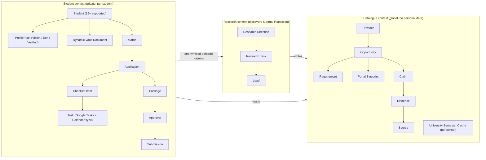
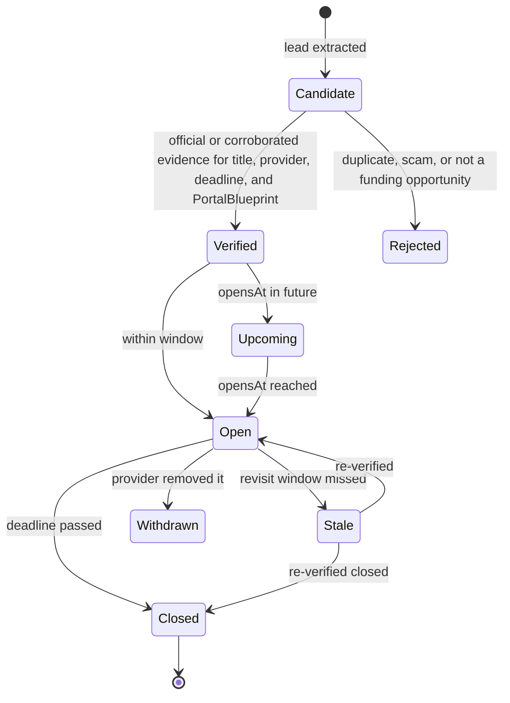

# 04 · Domain model

Vocabulary is defined in [`GLOSSARY.md`](../GLOSSARY.md). This file defines shapes, ownership, and lifecycles. The frontend's TypeScript types (`apps/mobile/src/domain/types.ts` and `apps/mobile/src/domain/nigeriaStatesLgas.ts`) and the backend schema (Phase 2+) both derive from this file.

## 1. Bounded contexts



**Ownership rule:** each entity has exactly one writing module. Student code never writes Catalogue rows; the discovery agent never reads private student rows. It only sees aggregated Demand Signals.

---

## 2. Catalogue context

### 2.1 Claim: the core provenance shape

Every factual field on an Opportunity or Portal Blueprint is a Claim, not a bare value.

```ts
type Verification =
  | "official"      // stated by the provider's own source or portal
  | "corroborated"  // stated by >=2 independent non-official sources
  | "inferred"      // derived from incomplete evidence; shown with caution
  | "unknown"       // source is silent; never filled by the model
  | "conflicting";  // sources disagree; both values retained

interface Claim<T> {
  value: T | null;              // null when unknown
  verification: Verification;
  evidence: EvidenceRef[];      // >=1 unless unknown
  lastVerifiedAt: string;       // ISO timestamp
}

interface EvidenceRef {
  sourceId: string;
  url: string;
  passage: string;              // exact quoted text, trimmed
  retrievedAt: string;
  locator?: string;             // page number, CSS path, or PDF page/bbox
}
```

### 2.2 Opportunity

| Field | Type | Notes |
|-------|------|-------|
| id, slug | string | stable |
| title | Claim\<string\> | |
| provider | ref Provider | university, foundation, government, company, trust |
| officialUrl | Claim\<url\> | canonical source |
| applicationUrl | Claim\<url\> | target portal URL |
| studyLevels | Claim\<StudyLevel[]\> | `secondary`, `undergraduate`, `masters`, `phd`, `postdoc`, `vocational` |
| fields | Claim\<string[]\> | normalised discipline taxonomy |
| eligibleNationalities | Claim\<CountryCode[] \| "any"\> | |
| hostCountries | Claim\<CountryCode[]\> | where study happens |
| funding | Claim\<Funding\> | tuition, stipend, travel, amount + currency where stated |
| opensAt, deadline | Claim\<ZonedDate\> | deadline carries its own timezone |
| requirements | Requirement[] | see below |
| portalBlueprint | PortalBlueprint | mapped via safe dry-run crawl before preparing student documents |
| status | OpportunityStatus | derived, see lifecycle |
| cycle | string | e.g. `2026/2027`; recurring programmes get one Opportunity per cycle |

### 2.3 Portal Blueprint (inspected BEFORE document preparation)

Before Artrat prepares documents for an Opportunity, its browser inspector maps the target portal in a safe dry run:

```ts
type AutomationPolicy =
  | "permitted"            // no prohibition found -> 100% autonomous execution (default)
  | "explicitly_banned";   // portal terms explicitly forbid automation -> fallback to Submission Kit

interface PortalBlueprint {
  id: string;
  opportunityId: string;
  portalUrl: string;
  version: number;
  fields: PortalFieldSpec[];
  uploads: PortalUploadSpec[];      // exact doc types, formats, max KB/MB, signature rules
  essayPrompts: PortalEssaySpec[];  // exact prompts, word/char limits
  declarations: string[];           // exact declaration text on the portal
  authSteps: ("login" | "oauth" | "email_otp" | "captcha" | "mfa")[];
  automationPolicy: Claim<AutomationPolicy>;
  inspectedAt: string;
}
```

### 2.4 Requirement (Dynamic — Never Hardcoded to One Signer)

A criterion or artefact the Opportunity demands. Endorsement letters and on-request documents are modeled dynamically so any signer role (`academic_referee`, `mentor`, `guarantor`, `clergy`, `hod`, `dean`, `exam_officer`) or document type can be requested when a specific scholarship requires it:

```ts
type Requirement =
  | { kind: "criterion"; key: CriterionKey; rule: Rule; hard: boolean; claim: Claim<string> }
  | { kind: "document"; docType: DocumentType; constraints: DocConstraints; signedBy?: SignerRole; onRequestOnly?: boolean; claim: Claim<string> }
  | { kind: "essay"; promptId: string; wordLimit?: number; claim: Claim<string> }
  | { kind: "referee"; count: number; roles?: SignerRole[]; claim: Claim<string> };

type CriterionKey =
  | "nationality" | "studyLevel" | "field" | "cgpa" | "jambScore"
  | "age" | "income" | "gender" | "stateOfOrigin" | "lga"
  | "institution" | "orphanOrFatherless" | "disability" | "other";

type SignerRole =
  | "academic_referee" | "mentor" | "guarantor" | "hod" | "dean"
  | "exam_officer" | "employer" | "community_leader" | "clergy" | "guardian" | "other";
```

### 2.5 University Semester Cache (Global Per-University Record)

Because Nigerian universities frequently deviate from printed calendars, Artrat verifies each university's active session and semester from live portal/exam signals and caches it globally per institution:

```ts
interface UniversitySemesterRecord {
  universityName: string;
  shortCode: string;                     // e.g. "UNN", "UNILAG", "ABU"
  currentSession: string;                // e.g. "2025/2026 Academic Session"
  currentSemester: "1st Semester" | "2nd Semester" | "Session Break / Exam Processing";
  verificationSource: string;            // live portal / departmental exam timetable signal
  lastCheckedAt: string;                 // cached globally so same school does not re-check
  nextLevelPromotionWindow: string;      // used to autonomously promote student levels across sessions
}
```

### 2.6 Opportunity lifecycle



---

## 3. Student context

### 3.1 Student & Academic Level Controls (including Under-18 Undergraduates)

```ts
interface Student {
  id: string;
  fullName: string;
  dateOfBirth: string;                   // selected via DOB Date Picker (DD/MM/YYYY)
  isMinor: boolean;                      // computed from DOB (<18); enables NDPA minor-safe defaults
  institution: string;
  department: string;
  matricNumber: string;
  academicLevel: "100 Level" | "200 Level" | "300 Level" | "400 Level" | "500 Level" | "600 Level";
  autonomousLevelPromotion: boolean;     // true by default (uses UniversitySemesterRecord); can be force-overridden in Settings
  stateOfOrigin: string;                 // selected from 36 Nigerian States + FCT dropdown
  lga: string;                           // selected from 774 official Nigerian LGAs cascading dropdown
  residentialAddress: string;            // student's residential/hostel writing address
  locale: string;
  timezone: string;
}
```

### 3.2 Profile Facts (with Origin & Conflict Detection)

Profile data is stored as **Profile Facts**, each with its origin (`self_reported`, `document_extracted` via Vision AI, or `verified`). During onboarding, `cgpa` and `jambScore` are extracted via Vision AI from the student's uploaded Transcript/Exam Officer Result Sheet and JAMB UTME Result Slip rather than typed manually in Step 2:

```ts
type FactOrigin = "self_reported" | "document_extracted" | "verified";

interface ProfileFact<T = string> {
  id: string;
  key: string;              // "cgpa", "jambScore", "parentStatus", "feesSponsor", "disability", etc.
  label: string;
  value: T;
  origin: FactOrigin;
  sourceDetail: string;     // e.g. "Vision OCR from JAMB Original Result Slip"
  documentId?: string;
  conflictsWith?: string[];
  updatedAt: string;
}
```

### 3.3 Dynamic Vault Documents (Distinct School vs. JAMB Admission Letters)

The Vault is **dynamic**: in addition to core onboarding documents, any new document or endorsement letter requested by an application is stored in the Vault and synced globally across all applications.

**Critical separation rule:** `school_admission_letter` (`University Admission Letter`) and `jamb_admission_letter` (`JAMB CAPS Official Admission Letter`) are **always separate document records** and must never be merged.

| Category / Type | Collected When | Notes |
|-----------------|----------------|-------|
| `waec_result` | Onboarding Interview Step 1 | Vision extracts O'Level distinctions & sitting year |
| `jamb_result` | Onboarding Interview Step 2 | Vision extracts UTME Aggregate Score (`308/400`) & Reg No |
| `school_admission_letter` | Onboarding Interview Step 3 | **Admission Letter from School** (University Admission Letter — separate!) |
| `jamb_admission_letter` | Onboarding Interview Step 4 | **Admission Letter from JAMB** (JAMB CAPS Official Admission Letter — separate!) |
| `school_id` | Onboarding Interview Step 5 | Accepts **University ID Card**, **Departmental ID Card**, or **Library Card** |
| `nin_slip` | Onboarding Interview Step 6 | Vision extracts 11-digit NIN & cross-checks legal name/DOB |
| `passport_photo` | Onboarding Interview Step 7 | Vision verifies framing, background, and KB size |
| `cv` | Onboarding Interview Steps 9–10 | Built from scratch or uploaded, with section-by-section AI questioning |
| `transcript` | Onboarding Interview Step 14 (Last) | Official Transcript or **Departmental Exam Officer-compiled semester result sheet** (even 1 semester); Vision extracts CGPA (`4.21/5.00`) |
| `lga_certificate` | **On-Request Only** | Requested dynamically only when a specific scholarship requires LGA Certificate of Origin |
| `bank_statement` | **On-Request Only** | Pulled via **Instant Bank Statement Connector (Mono/Okra)** or uploaded when a scholarship requests a 3–6 month statement |
| `dynamic_endorsement` | **On-Request Only** | Referee letter, Academic Mentor letter, Guarantor form, Clergy letter, or HOD verification letter—requested dynamically per scholarship and synced globally |

### 3.4 Application lifecycle

```mermaid
stateDiagram-v2
  [*] --> PortalInspectionPending: opportunity discovered / link dropped
  PortalInspectionPending --> PortalMapped: dry-run crawl produces PortalBlueprint
  PortalMapped --> Preparing: AI & Vault services prepare answers, CV, and drafts in portal sequence
  Preparing --> WaitingForRequirements: missing physical endorsement or on-request doc; Google Tasks & Calendar triggered
  WaitingForRequirements --> Preparing: required document uploaded & validated in app (syncs to global Vault)
  Preparing --> ReadyForReview: all blueprint fields, uploads, and writeups ready
  ReadyForReview --> ApprovedForExecution: student taps Declare & Submit (bound to package hash)
  ApprovedForExecution --> Executing: cloud browser runs end-to-end + reads Gmail OTPs autonomously
  ApprovedForExecution --> SubmissionKitExported: student downloads .DOCX / .PDF Submission Kit (or portal bans automation)
  Executing --> VerifyingSubmission: submit clicked; verify portal state / Gmail receipt before any retry
  VerifyingSubmission --> Submitted: official confirmation receipt captured in Vault & Chat
  Executing --> Submitted: official confirmation receipt captured in Vault & Chat
```



### 3.5 Persistent Checklist Item & Google Tasks / Calendar Trigger

Each missing physical requirement produces a `ChecklistItem` and a linked `Task` with a stable key (`applicationId + requirementRef`):

```ts
interface Task {
  id: string;
  studentId: string;
  applicationId: string;
  checklistItemKey: string;         // stable key for idempotency
  title: string;
  status: "open" | "satisfied";     // cannot be manually set to "satisfied" when manualCompletionAllowed = false
  manualCompletionAllowed: boolean; // false for signed endorsement letters / required uploads
  dueAt: string;
  triggerSchedule: {
    intervalHours: number;          // re-triggers until document is validated in app
    lastTriggeredAt: string;
    nextTriggerAt: string;
  };
  connectors: {
    googleTaskId?: string;          // synced to Google Tasks; auto-reopened if completed externally before upload
    googleCalendarEventId?: string; // synced to Google Calendar
    syncStatus: "synced" | "pending" | "error";
  };
}
```

### 3.6 Package, Approval, Submission & Downloadable Submission Kit

- **Package**: frozen, versioned snapshot of answers, drafts, and document versions (`packageHash`).
- **Approval**: immutable record of `Declare & Submit` (`applicationId`, `packageVersion`, `packageHash`, `declarationText`, `approvedAt`). Any Package change invalidates it.
- **Submission**: autonomous execution record with idempotency key, Gmail OTP pickup log, portal reference, and archived confirmation receipt.
- **Submission Kit**: downloadable `.DOCX` (Word) and `.PDF` package generated from the ordered Application items.
