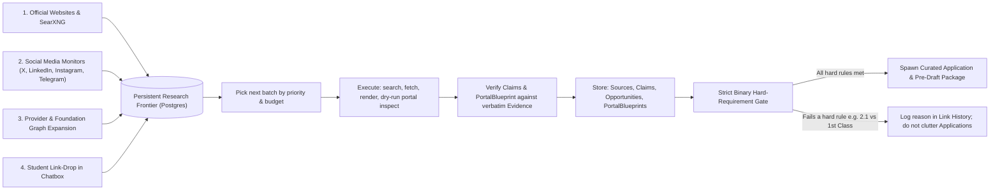

# 05 · Discovery agent: Research Frontier, Social Media Scouting & Student Link-Drop Enrichment

The discovery agent runs autonomously in the background so the student never has to search, filter, or click a manual "run sweep" button. It keeps the Catalogue complete, current, and verified, inspects portals in dry-run mode (`PortalBlueprint`), checks live university semester states (`UniversitySemesterCache`), and curates Applications only for students who meet 100% of hard eligibility requirements.

## 1. Four Discovery Channels Feeding One Persistent Frontier



1. **Web & Metasearch (`SearXNG` + `Crawl4AI`):** Autonomous queries across university funding pages, government ministries, trusts, corporate foundations, and international fellowships.
2. **Social Media Opportunity Scouting:** Scheduled discovery passes over public scholarship announcements on **X (Twitter)**, **LinkedIn**, **Instagram**, and public scholarship channels where local trusts, foundations, and bursaries are often posted before they rank on search engines. Every social lead is traced back to the official portal URL before verification.
3. **Provider Graph Expansion:** When Artrat discovers one scholarship from a foundation or corporate sponsor, it crawls the provider's other programmes and partner universities.
4. **Student Link-Drop Enrichment:** When a student drops an uncaptured scholarship URL into the Home or Applications chatbox:
   - Artrat immediately prioritizes a dry-run crawl of that URL.
   - If valid, Artrat adds the opportunity, its provider domain, and its discovery pattern into the **Autonomous Discovery Library**, spawning follow-up `expand_provider` and `explore` tasks so all matching students benefit.

---

## 2. Research Task Types

Every step is a durable job in Postgres. A crash loses at most the in-flight task, which is retried by key.

| Type | Input | Output |
|------|-------|--------|
| `search` | query, Direction | Leads (URLs with snippets) |
| `fetch` | URL | Snapshot (HTML or PDF) in object storage, content hash |
| `render` | URL | Rendered snapshot via Playwright browser worker (when static `fetch` is insufficient) |
| `inspect_portal` | applicationUrl | Safe dry-run **Portal Blueprint** (exact fields, separate upload slots, file caps, essay prompts, automation policy) |
| `check_university_semester` | universityName / domain | Verified `UniversitySemesterRecord` (`currentSession`, `currentSemester`), cached globally per school |
| `extract` | Snapshot | Candidate Opportunities and Provider mentions with verbatim Evidence passages |
| `explore` | Source domain | Links worth following (funding, scholarships, bursaries, postgraduate pages) |
| `verify` | Opportunity | Upgraded or downgraded Claims; status transition |
| `revisit` | Source | Change detection by hash, then diff, then targeted `extract` |
| `expand_provider` | Provider | Sibling programmes and partner institutions |

---

## 3. Priority Scoring & Thompson-Sampling Adaptation

Each candidate task gets a score. Weights live in config and are tuned against outcomes:

```
priority = w_rel·relevance + w_nov·novelty + w_gap·evidence_gap + w_fresh·freshness_due
         + w_dem·demand + w_dir·direction_yield − w_cost·expected_cost − w_fail·failure_penalty
```

| Signal | Meaning | Computed from |
|--------|---------|---------------|
| `relevance` | Likely to yield a real funding opportunity | Lead text classifier, Source history |
| `novelty` | Not already known | URL canonicalisation, content hash, embedding similarity to known Opportunities |
| `evidence_gap` | Important Claims or Portal Blueprint fields still unknown | Opportunity Claims |
| `freshness_due` | Revisit window elapsed or deadline approaching | Source revisit schedule |
| `demand` | Students need this coverage (including orphan/fatherless, disability, state/LGA, or course segments) | Anonymised Demand Signals |
| `direction_yield` | This Direction historically produces verified Opportunities | Direction statistics |
| `expected_cost` | Tokens, browser minutes, fetches | Task type averages |
| `failure_penalty` | Repeated failures on this domain or URL | Task history |

### How it adapts (explicit bookkeeping, not model retraining)

- Every **Research Direction** tracks attempts, Leads, verified Opportunities, expired Opportunities, and cost.
- Directions are chosen with an explore/exploit policy (**Thompson sampling** over verified-per-cost). Productive Directions get more budget; low-yield Directions decay but are retried occasionally.
- Sources get adaptive revisit intervals: shorten when content changes or a deadline nears, lengthen when stable.
- Every task stores **why** it was chosen (scores at selection time) so outcomes can be joined back to choices and evaluated offline.

---

## 4. Strict Binary Qualification vs. Obtainable Requirements

Artrat never computes a misleading "90% qualified" score. After building the `PortalBlueprint`, the matcher classifies every requirement into two strict buckets:

| Bucket | Examples | Rule |
|--------|----------|------|
| **Hard Identity / Academic Rules** | Required CGPA / Class of Degree (`First Class >= 4.50`), Study Level (`100L–400L`), Course (`Electrical Engineering`), Nationality, Age, State of Origin / LGA, Parental Status (`Orphan / Fatherless`), Disability criteria | **Must be 100% satisfied.** A student with a `2.1` (`4.21`) fails a `First Class` rule immediately—even if they have every other document ready. |
| **Obtainable Application Requirements** | Passport photograph, Transcript / Exam Officer sheet, separate School & JAMB Admission Letters, School/Dept/Library ID, NIN, CV, Essays, or **on-request** items (Referee/Mentor/Guarantor/HOD letter, LGA Certificate, Bank Statement) | **Can be prepared or provided.** If all Hard Rules pass, Artrat curates the Application, drafts the writeups, slots in existing Vault documents, and triggers **Google Tasks + Google Calendar** for any missing physical item. |

---

## 5. Guardrails & Verification Rules (Enforced in Code)

| Guardrail | Rule |
|-----------|------|
| **Budgets** | Per cycle: max tokens, max fetches, max browser minutes. Per day: global cost ceiling |
| **Politeness** | `robots.txt` honoured for discovery crawls; per-domain concurrency 1–2; delay with jitter |
| **Deduplication** | Canonical URL, content hash, then `(provider, title, cycle)` key, then embedding similarity flagged for review. Similarity alone never merges |
| **Loop prevention** | Max depth from seed; max pages per domain per cycle; visited-set; stop when novelty falls below threshold |
| **SSRF defence** | Fetchers resolve DNS and refuse private, loopback, and link-local ranges; all egress through a proxy |
| **Prompt injection** | Page text goes to the model as quoted data inside a fixed extraction schema. The model has no tools during extraction. Instructions found in pages are ignored and flagged |
| **Verbatim evidence** | Each cited passage must string-match the stored snapshot (`official`, `corroborated`, `conflicting`, `inferred`, or `unknown`). A model cannot cite text that is not present in the snapshot |

## 6. Tooling Choices & Evaluation Harness

| Need | Choice | Disposition (S5 vocabulary) |
|------|--------|---------------------------|
| Metasearch | SearXNG | DEPLOY |
| Fetch and clean HTML to Markdown | Crawl4AI or httpx + trafilatura | BENCHMARK, pick one in Phase 2 week 1 |
| JS rendering & Dry-Run Portal Inspector | Playwright (browser worker) | EXTRACT as dependency |
| PDFs, tables & Vision OCR | Docling + Vision LLM | BENCHMARK against Unstructured, then DEPLOY |
| Structured output | Pydantic models + model gateway | MODEL |
| Durable jobs | Postgres queue | DEPLOY |
| Agent framework | Custom planner over the frontier | LangGraph: REFERENCE |

**Evaluation harness:** A fixed corpus of saved pages, portal snapshots, and PDFs (official pages, mirrored listings, expired calls, conflicting deadlines, JS portals, injected instructions) with expected extractions, run on every prompt or model change.
