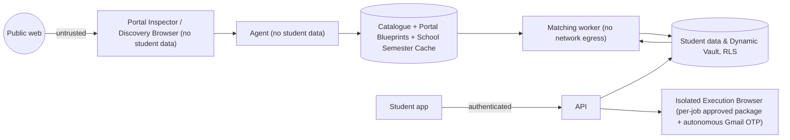

# 06 · Trust, safety, security, and privacy

S6 §21 and S5 §8 remain the baseline. This file lists what is specific to Artrat's shape and what must be designed in from the first commit. Run the `never-get-hacked` and `security-review` skills against each phase before it ships.

## 1. Data classes

| Class | Examples | Controls |
|-------|----------|----------|
| **Highly sensitive** | National ID / NIN slip, Passport photo, WAEC/JAMB results, separate School & JAMB Admission Letters, Transcripts / Exam Officer sheets, Bank Account details, on-request Bank Statements (Mono/Okra), Disability & Deceased-Parent records, OAuth refresh tokens | Encrypted object storage, per-student keys or envelope encryption, access only via short-lived signed URLs from the API, every read audited |
| **Sensitive personal** | Profile Facts (including DOB Date Picker & under-18 status, State/LGA, residential address, tuition/accommodation sponsors), CV sections, essays, dynamic referee/mentor/guarantor/HOD contacts, application answers | Row-level security (RLS) in Postgres keyed by student, encryption at rest, never logged |
| **Operational** | Research Tasks, Direction stats, Portal Blueprints, cached University Semester records (`UniversitySemesterCache`), metrics | Normal access control |
| **Public** | Opportunity Claims and verbatim Evidence | Integrity and provenance, treated as untrusted input |

## 2. Trust boundaries

- **Dry-run vs Execution separation:** The Portal Inspector (which crawls and maps a portal before documents are processed) and the University Semester Checker never hold student credentials or documents. The Execution Browser (which runs after `Declare & Submit`) runs in a dedicated, ephemeral per-job container with only that application's approved package.
- **Zero student leakage to Research:** The matching worker is the only place Catalogue and Student data meet, and it has no network egress.

## 3. Rules that code enforces

1. **Ownership on every request.** The student ID comes from the verified auth token, never from the request body. Postgres RLS enforces isolation as a second line.
2. **Portal Inspection before preparation.** `Preparing` requires a valid `PortalBlueprint` so documents (e.g., separate School vs. JAMB Admission Letters, PDF KB caps) and answers are validated against the real portal form.
3. **Approval binding (`Declare & Submit`).** `Declare & Submit` is accepted only if the submitted `packageHash` equals the current `packageHash` and Readiness is 100%. Any Package change voids the Approval.
4. **100% autonomous execution & scoped Gmail OTP pickup.** When Gmail is connected, Artrat's execution worker reads only incoming verification OTPs and official confirmation receipts from known scholarship portal domains, neverunrelated personal correspondence. It never bypasses CAPTCHAs, MFA challenges, or fee payments.
5. **No manual bypass on physical signature requirements.** Dynamic endorsement Checklist Items (whether from an Academic Referee, Mentor, Guarantor, or HOD) have `manualCompletionAllowed = false`. If a student marks the synced Google Task complete in Google Tasks without uploading a validated signed document in Artrat, the sync worker re-opens and re-triggers the Google Task automatically.
6. **Scoped Bank Statement Connector (On-Request Only).** The Mono/Okra Bank Statement connector is invoked **only** when a specific scholarship portal requires a certified bank statement, using read-only statement scope and storing the generated statement in the encrypted Vault.
7. **Verify before retry.** If a portal submission response is ambiguous, the worker enters `VerifyingSubmission` and checks portal state and Gmail confirmation emails before any retry—guaranteeing zero duplicate submissions.
8. **Model output is untrusted.** Every LLM or Vision OCR response is parsed into a strict schema; failures are retried or dropped, never coerced.
9. **Verbatim evidence.** Evidence passages must string-match the stored snapshot.
10. **SSRF & upload hardening.** All web fetches resolve DNS and block private/loopback/link-local ranges through an egress proxy. Uploaded documents undergo MIME sniffing, size checks, malware scanning, and sandboxed PDF/image normalization.

## 4. Writing integrity

- Drafts may use only **Evidence Ledger** entries (verified from the student's Vision-extracted documents, CV interview, personal/community origin story, and family/sponsorship context).
- Every factual sentence in a draft maps to a ledger entry; unmapped claims are blocked.
- No AI-detector-evasion tricks—clarity and the student's authentic **Voice Profile** govern every draft.

## 5. Under-18 Undergraduate Support & NDPA 2023 Compliance

- **First-class under-18 support:** Because a large share of Nigerian university undergraduates (100L–200L) and JAMB entrants are 15–17 years old, Artrat serves under-18 students as first-class users.
- **Age-appropriate protections (Nigeria Data Protection Act 2023):**
  - The **Date of Birth (DOB) Date Picker** in Step 2 automatically detects when a student is under 18 and activates minor-safe privacy defaults (zero third-party tracking, strict data minimization, plain-language consent, and optional guardian link where required).
  - Sensitive family/financial/disability stories collected during the AI Onboarding Interview are used strictly for matching eligible scholarships (such as orphan/fatherless or disability-inclusive awards) and crafting student-approved personal statements.
  - Full one-tap data export (`.JSON` / `.PDF`) and permanent account deletion are available in Settings at any time.

## 6. Threats tested before each phase ships

IDOR across students; token leakage in logs; prompt injection through web pages, PDFs, emails, and uploaded documents; SSRF via student-dropped URLs; malicious file uploads; duplicate submissions after a crash; approval replay with a stale package hash; Google Tasks or Calendar duplication under retries.
