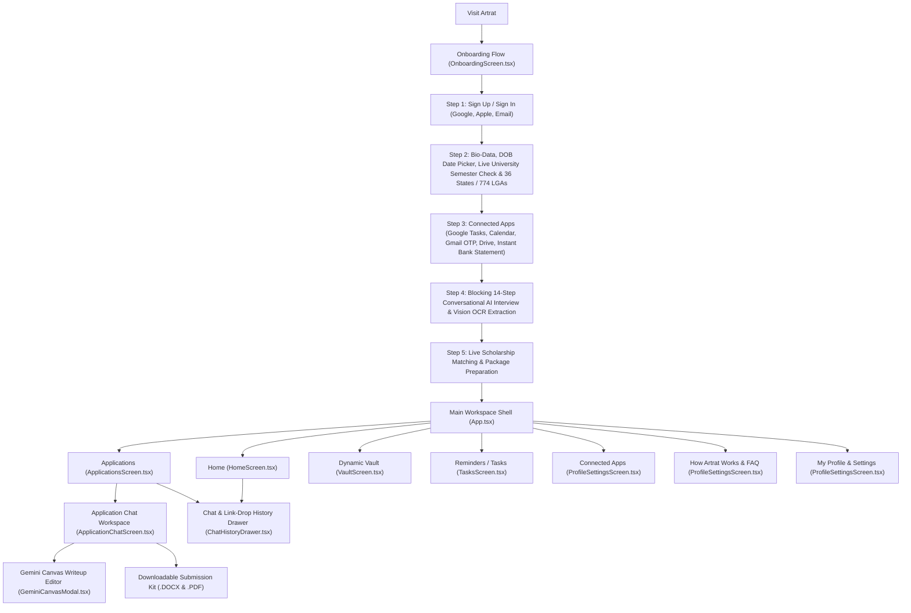

# 08 · Frontend Plan & Implemented Prototype Architecture (Phase 1)

**Status:** Active (`apps/mobile`)  
**Design Direction:** `editorial-greeting` (`taste-skill` seed `813620756`) + `apple-design-skill` + `shadcn` composition  
**Companion Onboarding Spec:** [`docs/09-onboarding-discovery-interview-spec.md`](09-onboarding-discovery-interview-spec.md)

---

## 1. Visual & UX Architecture

### 1.1 Flat Tonal Surfaces; Only the Mascot Is a 3D Model
- **Zero 3D Bevels on UI Controls:** Cards, panels, buttons, modals, and navigation bars use clean, flat tonal separation (`#F8F7FC` lavender-tinted canvas, `#F1EEF8` tonal panels, `#FFFFFF` crisp cards with `1px` `#E6E1F0` borders, `#6D28D9` primary violet accent, `#0F172A` high-contrast ink).
- **Real Three.js WebGL 3D Mascot (`ArtratBot3D.tsx`):** The **only** 3D object in the UI is the interactive Three.js (`THREE.WebGLRenderer`) non-human companion model:
  - Sculpted clearcoat head/chassis (`THREE.MeshPhysicalMaterial`), curved obsidian visor, emissive 3D capsule eyes that blink naturally and track the pointer in 3D space, magnetic floating ear pods, and an orbital halo ring.
- **Banned Icon Rule:** The `Sparkles` icon is strictly banned across the entire project; semantic icons (`Wand2`, `Layers`, `Cpu`, `CheckCircle2`, `ShieldCheck`, etc.) are used instead.

### 1.2 Responsive Open-Plane Shell (`App.tsx`)
- **Desktop (`>= 860px`):**
  - Left sidebar (`248px`) with student profile card, primary navigation (`Home`, `Applications`, `Vault`, `Reminders`, `Connected Apps`, `How It Works & FAQ`, `Settings`), and quick Onboarding preview trigger.
  - All modals (Notifications popover, Profile/Settings modals, Dropdown pickers, Upload dialogs) render centered with clean backdrop overlays.
- **Mobile (`< 860px`):**
  - Compact top header (`52px`) + bottom navigation bar (`Home`, `Applications`, `Vault`, `Reminders`) + full-featured slide-over menu drawer.
  - **Scroll-Aware Auto-Hiding Chrome in `Applications`:** On mobile inside the `Applications` tab, scrolling down smoothly hides the bottom navigation bar and sticky bottom chatbox so the student gets maximum vertical screen space; scrolling up or reaching the top brings them right back.

---

## 2. Information Architecture & Screen Inventory

| Screen / Component | File | Key Responsibilities |
|--------------------|------|----------------------|
| **1. Onboarding & 14-Step AI Interview** | [`OnboardingScreen.tsx`](../apps/mobile/src/ui/OnboardingScreen.tsx) | Sign-Up/Sign-In -> Bio-Data (DOB Date Picker, University Selector with Live Semester Check & School Cache, 36 States + FCT & 774 LGAs cascading dropdowns, no upfront CGPA/UTME, no referee note) -> Connected Apps (incl. Instant Bank Statement Connector) -> 14-step one-by-one AI Interview with Vision OCR extraction -> Live Matching. |
| **2. Nigerian States, 774 LGAs & University Cache** | [`nigeriaStatesLgas.ts`](../apps/mobile/src/domain/nigeriaStatesLgas.ts) | Complete dataset of all 36 Nigerian States + FCT and all 774 official LGAs, plus `INITIAL_UNIVERSITY_SEMESTER_CACHE` and popular Nigerian universities. |
| **3. Student Home (`Home`)** | [`HomeScreen.tsx`](../apps/mobile/src/ui/HomeScreen.tsx) | Personal greeting (`"Morning, Chisom."`), live status finding with `ArtratBot3D`, Link-Drop & Assistant Composer, 4 tonal summary tiles, *Waiting on you* panel, and *Prepared & ready to review* panel. |
| **4. Curated Applications (`Applications`)** | [`ApplicationsScreen.tsx`](../apps/mobile/src/ui/ApplicationsScreen.tsx) | Filter pills (`All`, `Ready to Submit`, `Action Needed`, `Submitted`), curated Application cards (zero match percentages—strict binary eligibility), compact **Downloadable Submission Kit** buttons (`.DOCX` Word & `.PDF`), and scroll-aware sticky bottom chatbox. |
| **5. Application Chat Workspace** | [`ApplicationChatScreen.tsx`](../apps/mobile/src/ui/ApplicationChatScreen.tsx) | Displays all required documents and writeups **in exact portal order** (`Item 1` -> `Item 5`), inline document replacement (synced globally to Vault), `Edit writeup in Canvas`, compact `.DOCX`/`.PDF` Submission Kit download bar, and the version-bound **Declare & Submit** card with 100% autonomous cloud execution & Gmail OTP pickup. |
| **6. Gemini Canvas Modal** | [`GeminiCanvasModal.tsx`](../apps/mobile/src/ui/GeminiCanvasModal.tsx) | Interactive essay/letter editor with direct text editing, AI refinement prompts (*"Make opening stronger"*, *"Highlight lab project"*, *"Tighten to word limit"*), word count tracker, and Evidence Ledger grounding chips. |
| **7. Dynamic Vault (`Vault`)** | [`VaultScreen.tsx`](../apps/mobile/src/ui/VaultScreen.tsx) | Dynamic document store supporting any scholarship requirement (`Core Academic`, `Identity & Origin`, `Endorsements & References`, `Essays & Writeups`, `On-Request Financial`), keeping **School Admission Letter** and **JAMB Admission Letter** strictly separate, with responsive mobile metadata tag alignment, custom document type addition, and Profile Facts editor. |
| **8. Reminders (`Reminders`)** | [`TasksScreen.tsx`](../apps/mobile/src/ui/TasksScreen.tsx) | Persistent Google Tasks & Calendar loop for human-in-the-loop endorsements or uploads, including simulation of external Google Tasks completion auto-reopening when no document is uploaded in Artrat. |
| **9. Profile, Connected Apps, Settings & Guide** | [`ProfileSettingsScreen.tsx`](../apps/mobile/src/ui/ProfileSettingsScreen.tsx) | **My Profile:** DOB Date Picker, 36 States + 774 LGAs dropdowns, residential address, and global dynamic endorsement address sync. **Connected Apps:** Single cards per service (`Google Tasks`, `Google Calendar`, `Gmail`, `Google Drive`, `Instant Bank Statement (Mono/Okra)`, `WhatsApp`) with `i` info popover and interactive OAuth connection modal. **Settings:** **University Semester Tracker & Manual Level Force-Override (`100L`–`600L`)**, **Notification Preferences** toggles, and NDPA data controls. **How Artrat Works & FAQ:** Student-facing 5-step autonomous workflow & FAQ (highlighting 100% autonomous submission & Gmail OTP pickup). |
| **10. Chat & Link-Drop History Drawer** | [`ChatHistoryDrawer.tsx`](../apps/mobile/src/ui/ChatHistoryDrawer.tsx) | Unified history of Application threads and student-dropped scholarship links (showing whether a dropped link spawned a new Application or was excluded by a hard rule like First Class Honours). |

---

## 3. Core Interactive Invariants Verified in the Prototype

1. **First Workflow Is Sign-Up -> Bio-Data -> Connectors -> 14-Step AI Interview:**
   - Visiting Artrat launches the full onboarding flow first (`onboardingPreviewOpen = true` on initial load, and re-openable anytime via `Preview Onboarding` / `Restart AI Interview`).
2. **Separate School vs. JAMB Admission Letters:**
   - `vault-school-admission` (`University Admission Letter (From School)`) and `vault-jamb-admission` (`JAMB CAPS Official Admission Letter`) are distinct items in both the AI Interview and the Vault.
3. **Live University Semester Check & Manual Level Override:**
   - Selecting a university checks and caches its active semester once per school (`UniversitySemesterRecord`), enabling autonomous level promotion across sessions while giving the student a manual force-level override (`100 Level`–`600 Level`) in Settings.
4. **100% Autonomous Submission & Gmail OTP Pickup:**
   - No manual OTP request cards exist anywhere in the UI; connected Gmail handles verification codes and submission receipts autonomously.
5. **Downloadable Submission Kits in `.DOCX` and `.PDF`:**
   - Every application card and Application Chat header provides compact, mobile-friendly `.DOCX` (Word) and `.PDF` download actions.
